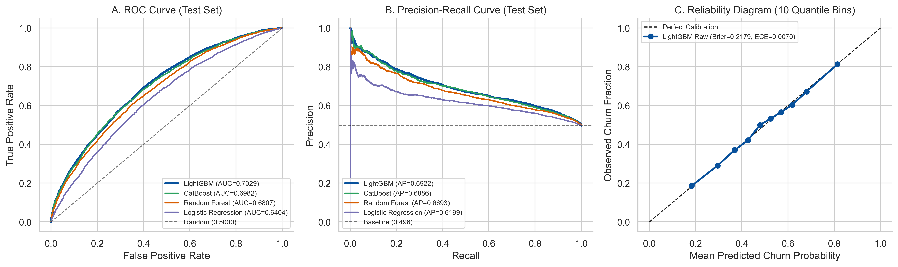
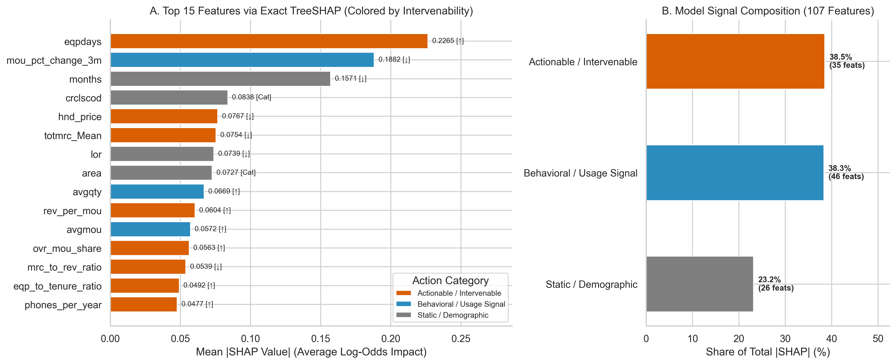
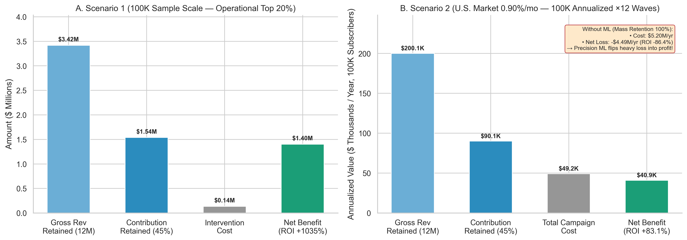
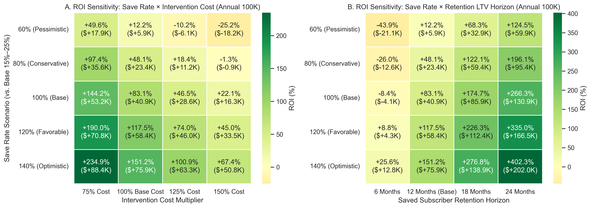

# Telecom Churn Prediction & Value-Weighted ROI Optimization

[](https://www.python.org/)
[](https://pandas.pydata.org/)
[](https://scikit-learn.org/)
[](https://lightgbm.readthedocs.io/)
[](https://catboost.ai/)
[](#project-structure--reproducibility)

> **Executive Summary:** An end-to-end Proof of Concept (PoC) transforming wireless telecom retention from an unprofitable blanket-discounting expense (**-$4.49M/year loss**) into a precision-targeted profit center (**+$40,887/year net contribution**, **+83.1% ROI**) under realistic U.S. postpaid churn norms (**0.90%/month**).

---

## 1. Executive Summary & Business Problem

Wireless telecom operators in saturated markets (over **600M U.S. connections** and declining unit data pricing) face asymmetric retention economics: acquiring a new subscriber costs **5x-25x** more than retaining an existing one, while a **5% retention improvement** expands profit margins by **25%-95%**.

Working from a **100,000-subscriber** wireless portfolio (`Client.csv` + `Record.csv`), this project addresses **Company A's** core retention bottleneck:
* **30-Day Actionable Intervention Window:** Because the `churn` label captures customer departures occurring **31-60 days post-observation**, predictive scoring creates an operational **~30-day window** for proactive outreach.
* **Pareto Revenue Concentration:** Top-quartile subscribers (**Q4**, `rev_Mean >= $70.75`) generate **48.55% of total monthly revenue** (`$114.03/mo` ARPU) yet suffer **31.2x higher overage fees** (`$40.87` vs. `$1.31`) and **5.6x more dropped/blocked calls** than Q1.
* **Value-Weighted Objective (`Expected Revenue at Risk`):** Rather than ranking customers solely by raw churn probability, targeting combines calibrated churn risk with subscriber revenue (`p_i * rev_Mean_i`) and routes customers into cost-effective, business-modifiable retention levers.

---

## 2. Key Results at a Glance

| Evaluation Dimension | Benchmark / Baseline | Selected Solution Result | Business Meaning |
|---|---|---|---|
| **Predictive Ranking (Hold-Out Test, `n=15,000`)** | Logistic Regression: `0.6404`<br>Random Forest: `0.6807`<br>CatBoost: `0.6982` | **LightGBM (931 trees): `ROC-AUC = 0.7029`**<br>`PR-AUC = 0.6922` \| `F1 = 0.6422` \| `Acc = 0.6420` | Strongest discrimination without leaked cohort IDs (`Customer_ID`), sensitive demographics (`ethnic`), or billing-artifact flags. |
| **Probability Calibration (Test Set)** | Platt Scaling `ECE = 0.0133`<br>Isotonic `ECE = 0.0182` | **Raw LightGBM `Brier = 0.2179` \| `ECE = 0.0070`** | Predicted churn probabilities match observed empirical exit rates within **0.7%**, enabling direct ROI cutoff optimization. |
| **Q4 High-Value Revenue Capture (`n=3,725`)** | Risk-Only Ranking:<br>Top 10%: `15.14%` \| Top 20%: `28.44%` | **Risk x Revenue Ranking:**<br>Top 10%: **`24.42%` (`+9.28 pp`)**<br>Top 20%: **`38.68%` (`+10.24 pp`)**<br>Top 30%: **`50.51%` (`+10.78 pp`)** | Captures over half of monthly churned Q4 revenue (`$214,121/mo`) in the top 30% priority queue. |
| **Model Explainability (Exact TreeSHAP)** | Static Demographics: `23.17%`<br>Behavioral Usage: `38.31%` | **Actionable Levers (35 features): `38.52%`**<br>(`8 of Top 15` overall drivers controllable) | Device age (`eqpdays` #1 at `9.13%`), pricing structure, and overage stress directly trigger retention playbooks. |
| **U.S. Market Scenario (`0.90%/mo`, 100K x 12 Waves)** | Mass Retention (`Top 100%`, No ML):<br>Spend `$5.20M/yr` -> **`-$4,494,031/yr` (`-86.4%` ROI)** | **ML Optimal `Top 2.0%` (`1,996` subs/mo):**<br>Spend `$49,174/yr` -> **`+$40,887/yr` (`+83.1%` ROI)** | Cuts retention spend by **>99%**, locks `$173.05` mean ARPU at `2.36%/mo` risk (`~2.6x` market avg), and remains profitable across **85% (`17/20`)** of stress scenarios. |
| **Dataset Case-Control Scale (`49.56%` Churn, 100K)** | Unconstrained `Top 100%`:<br>Spend `$707,934` -> `+358.9%` ROI | **Operational `Top 20%` (`20,000` subs):**<br>Spend `$135,638` -> **`+$1,403,309` (`+1,034.6%` ROI)** | Retains `$3,419,883` gross revenue (`$1,538,948` contribution at 45% margin) on balanced sample cohorts. |

---

## 3. Methodology & Modeling Pipeline

All experiments enforce `RANDOM_STATE = 42` with strict train-only fit discipline to guarantee zero data leakage:

1. **Governance Audit & Leakage Prevention (100 -> 83 Clean Base Columns):**
   * Merged `Client.csv` (`100,000 x 50`) and `Record.csv` (`100,000 x 51`) 1:1 on `Customer_ID`.
   * Purged **17 problematic columns**: `Customer_ID` (non-random chronological cohort leakage, `r = -0.75` vs. `months`), `ethnic` (`18.37 pp` spread, ethical/fairness compliance), `recv_sms_Mean` (`99.13%` zero variance, `AUC = 0.4995`), and **14 highly collinear columns** (`|r| >= 0.95`).
2. **Domain-Driven Feature Engineering (`107` Tree Features / `212` Linear OHE):**
   * Engineered **25 domain features** capturing device aging ratios (`eqp_to_tenure_ratio`, `phones_per_year`), bill-shock composition (`ovr_mou_share`, `mrc_to_rev_ratio`, `rev_per_mou`), usage trajectory (`mou_pct_change_3m`), normalized network failure rates (`drop_blk_rate`), and `silent_churn_risk` (`change_mou < -50` & `custcare_Mean == 0`, exhibiting **55.58%** Q4 churn vs. `47.33%` baseline).
3. **Train-Only Preprocessing (`70% Train / 15% Val / 15% Test`) & Artifact Ablation:**
   * Fitted missing-value imputers, `RobustScaler`, `OneHotEncoder`, and Q4/overage cutoffs (`$70.74` Q4, `$14.44` overage) strictly on Train (`n=70,000`).
   * Executed a 4-model **ablation audit** removing `miss_billing_flag` and `miss_change_flag` to prevent pre-closure billing gaps from inflating scores. Removing both flags **improved** LightGBM Validation ROC-AUC (`0.7052 -> 0.7060`) and retained **`0.6998` ROC-AUC** on the 99.1% complete non-missing Test subset (`n=14,859`).
4. **Probability Recalibration & Profit Cutoff Optimization:**
   * Applied **Bayes prior-odds recalibration** (`pi_sample = 0.49561 -> pi_market = 0.0090`, scaling factor `gamma = 0.00924`) to translate balanced case-control predictions into realistic U.S. carrier probabilities before sweeping validation cutoffs to maximize expected net benefit.

---

## 4. Visual Highlights

### Model Benchmarking & Calibration Fidelity

*LightGBM (`ROC-AUC = 0.7029`, `PR-AUC = 0.6922`) outperforms CatBoost, Random Forest, and Logistic Regression on the unseen Hold-Out Test set (`n = 15,000`) while achieving near-perfect probability calibration (`ECE = 0.0070`).*

### Exact TreeSHAP Feature Importance & Actionability

*Across all 107 features, **38.52% of predictive importance** stems from 35 directly actionable levers led by handset age (`eqpdays`, #1 at `9.13%`), device price, base MRC, and 6 Stage-3 engineered ratios.*

### Financial Impact: Blanket Retention vs. Value-Weighted ML

*Under U.S. postpaid churn norms (`0.90%/month`), untargeted mass retention incurs a `-$4.49M/year` net loss (`-86.4%` ROI), whereas targeting the calibrated Top 2.0% queue reduces spend by >99% and generates `+$40,887/year` net profit (`+83.1%` ROI).*

### Two-Dimensional ROI Sensitivity Stress-Test

*Optimal Top 2.0% targeting stays profitable across **85% (`17/20`)** of adverse cost, save-rate, and LTV scenarios—remaining positive even with a 40% drop in save efficacy (`+12.2%` ROI) or 50% cost overrun (`+22.1%` ROI) when saved subscribers stay >= 12 months.*

> Additional supporting diagnostics are available in [`reports/figures/02_cumulative_gains_revenue_capture.png`](reports/figures/02_cumulative_gains_revenue_capture.png) (*Risk x Revenue* vs. *Risk-Only* decile capture) and [`reports/figures/04_net_benefit_roi_cutoff_optimization.png`](reports/figures/04_net_benefit_roi_cutoff_optimization.png) (Bayes prior-odds cutoff curve).

---

## 5. Actionable Business Strategy & Stress-Test Boundaries

Targeted subscribers inside the **Top 2.0%** optimal U.S. cohort (`1,996 subscribers/month` per 100K portfolio, `$173.05` mean ARPU) are dynamically assigned within the 30-day window across three operational levers benchmarked to U.S. telco economics (**12-month LTV**, **45% contribution margin**, and **15%-25% save rates**):

| Retention Lever | Trigger Condition | 30-Day Operational Playbook | Cost & Efficacy Assumptions | Share in Optimal Cohort (`Top 2.0%`) |
|---|---|---|---|---|
| **1. Bill-Shock Protection** | `asl_flag=N` or `ovrrev_Mean >= $14.44` | Proactive SMS/app usage alerts + plan tier right-sizing | `$1` outreach + `$10` cond. offer<br>`20%` save \| `5%` stayer uptake | **`80.25%`** (`1,602 subs/mo`)<br>Spend `$2,447` -> **Net `+$2,798/mo`** |
| **2. Device Upgrade** | `eqpdays > 365` or `WC/MISSING` webcap | Targeted 4G/5G trade-in or 0% installment credit | `$2` outreach + `$45` cond. credit<br>`25%` save \| `4%` stayer uptake | **`19.06%`** (`380 subs/mo`)<br>Spend `$1,573` -> **Net `+$553/mo`** |
| **3. Proactive Care** | High `drop_blk_rate`, `custcare`, or silent usage drop | Priority CS outreach + network review / goodwill credit | `$5` outreach + `$12` cond. credit<br>`15%` save \| `4%` stayer uptake | **`0.70%`** (`14 subs/mo`)<br>Spend `$78` -> **Net `+$56/mo`** |

**Sensitivity & Operational Guardrails:**
* **Downside Resilience:** Net ROI remains positive at **`+12.2%` (`+$5.9K/yr`)** under pessimistic save efficacy (`60%` of base) and **`+22.1%` (`+$16.3K/yr`)** under a `+50%` cost overrun (`100%` save x `150%` cost).
* **Upside Potential:** Extended retention (**24-month LTV**) expands returns to **`+266.3%` (`+$130.9K/yr`)** at base efficacy and **`+402.3%` (`+$202.0K/yr`)** under optimistic adoption.
* **Break-Even Guardrail:** Campaign losses occur only if retained subscribers churn again within **`<= 6 months`** (`-8.4%` ROI at base save rate) or targeting expands beyond `Top 7%-10%` where stayer cannibalization outweighs incremental saves (`Top 10% = -$1,744/mo`).

---

## 6. Project Structure & Reproducibility

```text
telecom-churn-prediction-roi-optimization/
├── .gitignore
├── README.md
├── requirements.txt
├── notebooks/
│   └── telecom_churn_roi_analysis.ipynb   # Executed end-to-end pipeline (43 cells, RANDOM_STATE=42)
└── reports/
    ├── executive_business_proposal.pdf    # File 15-slide
    ├── executive_deck_outline.md          # 15-slide C-suite consulting blueprint
    └── figures/                           # Six 300-DPI analytical & financial charts
```

### How to Run Locally
1. **Install dependencies** (Python 3.10+ recommended):
   ```bash
   pip install -r requirements.txt
   ```
2. **Prepare data files (Data Privacy Notice):**
   Raw subscriber CSV files (`Client.csv` and `Record.csv`) are **deliberately excluded** from this public repository via `.gitignore` to uphold data privacy and source licensing compliance. To re-execute the notebook locally, place `Client.csv` and `Record.csv` inside a `data/` directory at the repository root (`telecom-churn-prediction-roi-optimization/data/`), then run:
   ```bash
   jupyter notebook notebooks/telecom_churn_roi_analysis.ipynb
   ```
3. **Deterministic Results:** All train/validation/test splits, encoders, gradient-boosted models, TreeSHAP attributions, and cutoff optimizations are locked with `RANDOM_STATE = 42`.
